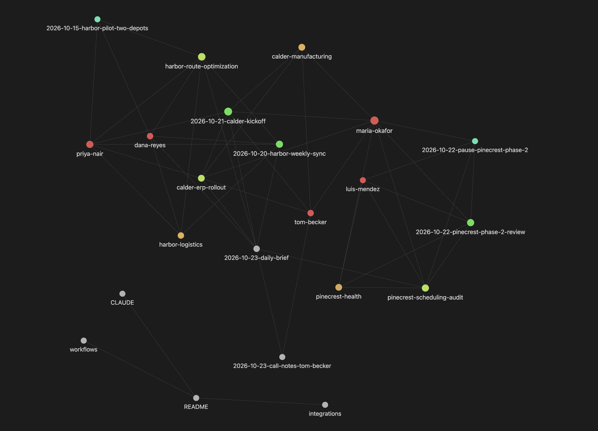
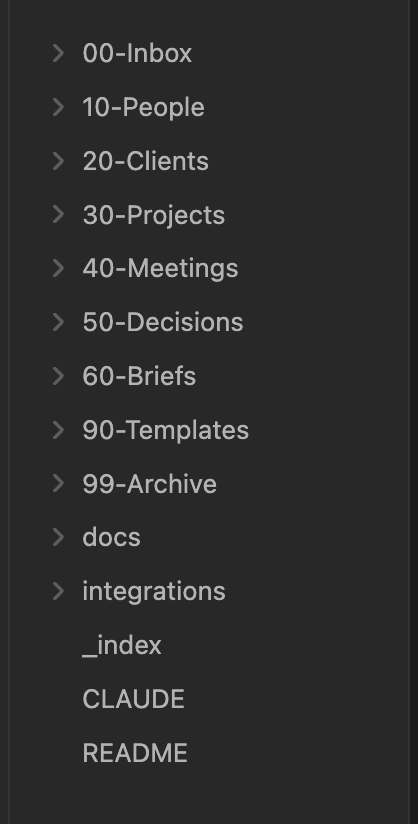
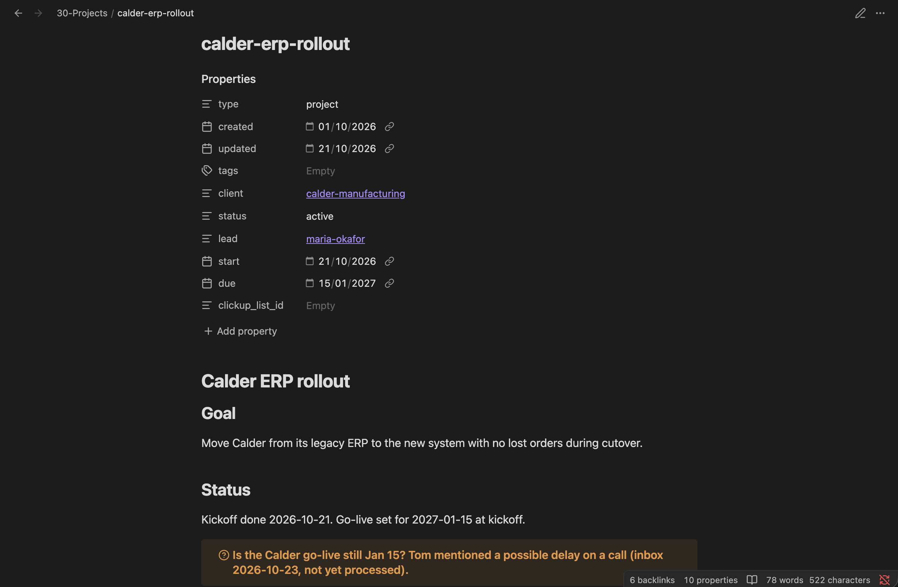
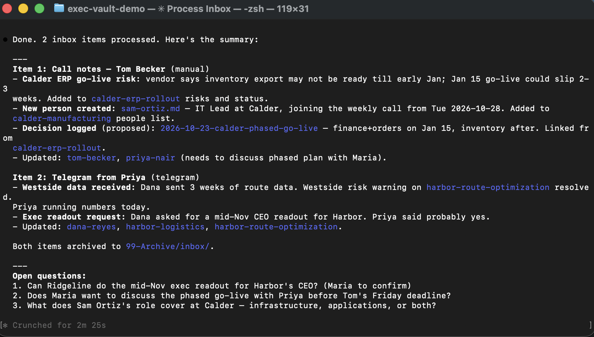
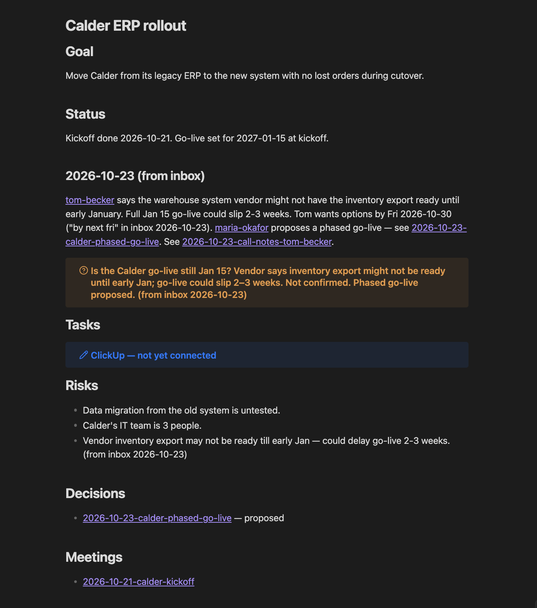

# Executive Knowledge Vault — Obsidian + Claude Code

A demo of a private knowledge vault for a leadership team, built as plain Markdown in Obsidian and maintained by Claude Code through a single rules file, [`CLAUDE.md`](CLAUDE.md).

All people, companies, and data here are **fictional** (Ridgeline Partners is a made-up consulting firm).

## What it shows

- **A folder structure an LLM can navigate cheaply** — numbered folders, one note per entity, an `_index.md` in every folder, and required YAML frontmatter so Claude can find notes with a search instead of reading everything.
- **A rules file that stays short** — `CLAUDE.md` holds the map, naming, hard rules, and workflow names. Details live in `docs/` and are read only when needed, which keeps every session's context small.
- **Repeatable workflows** — `process inbox`, `prep meetings`, `daily brief`, `log decision`, `weekly review`, each written as numbered steps in [`docs/workflows.md`](docs/workflows.md).
- **Safe defaults** — no deletes (archive instead), append-only decisions, open questions instead of guessed facts, nothing sent outside the vault without approval, one git commit per workflow.
- **Tool connections** — Google Calendar, ClickUp, Go High Level, Telegram. See [`docs/integrations.md`](docs/integrations.md) for setup and status.

## Structure

```
00-Inbox/        raw input (Telegram, quick notes) waiting to be sorted
10-People/       one note per contact
20-Clients/      one note per client account
30-Projects/     one note per engagement
40-Meetings/     YYYY-MM-DD-meeting-name.md
50-Decisions/    append-only decision log
60-Briefs/       generated daily / weekly briefs
90-Templates/    note templates (one per type)
99-Archive/      closed notes (nothing is deleted)
docs/            conventions, workflows, integrations
_index.md        map of the vault
CLAUDE.md        rules Claude Code follows
```

## Design choices

| Choice | Why |
|---|---|
| One entity per file, named by slug | Wiki-links stay stable; Claude can open a note by guessing its name |
| `_index.md` per folder with one-line summaries | Claude reads ~20 lines instead of 20 files to find the right note |
| Required frontmatter (`type`, `client`, `project`, `status`) | `grep` on frontmatter answers "all open Harbor work" without reading bodies |
| Rules file + `docs/` split | Rules load every session; details load only when the task needs them |
| Decisions are append-only | Executives need to see *why* something changed, not just the latest state |
| Sync date on every imported value | Calendar/ClickUp data goes stale; the date shows how fresh it is |
| Open-question callouts instead of guesses | An exec vault with invented facts is worse than one with gaps |

## Try it

1. Clone the repo and open the folder as a vault in Obsidian.
2. Open the folder in a terminal and run `claude`.
3. Try: `process inbox`, then `daily brief`, then ask "what's open with Calder?"

## Demo

**Linked vault** — people, clients, projects, meetings and decisions (templates and docs hidden):




**Folder structure** — numbered folders, one note per entity:



**A project note before processing** — frontmatter Claude can search on, and an open question instead of a guessed fact:



**`process inbox` run in Claude Code** — 2 raw notes sorted into the right files, a new contact created, a decision logged as *proposed*, open questions raised:



**The same project note after processing** — the go-live date is unchanged, the delay is recorded as a risk, and the phased go-live is only *proposed*:



## What the first test run caught

I checked every change from the first `process inbox` run. Two problems came up, and I added a rule to CLAUDE.md for each:

- **Wrong dates.** Claude guessed weekdays and got two dates wrong: "starting tues" became a Wednesday, and "by next fri" became a Saturday. Rule 7: check with `cal` before resolving a relative date, and keep the original words next to it.
- **Too much certainty.** Claude wrote "might not be ready" as "confirmed." Rule 8: keep the source's level of certainty.

## Status

| Part | Status |
|---|---|
| Folder structure, templates, sample notes | Done |
| CLAUDE.md and workflow docs | Done, tested with `process inbox` |
| Telegram inbox bot | Script written, not tested with a live bot |
| Google Calendar, ClickUp, Go High Level | Designed (see `docs/integrations.md`), not built |
